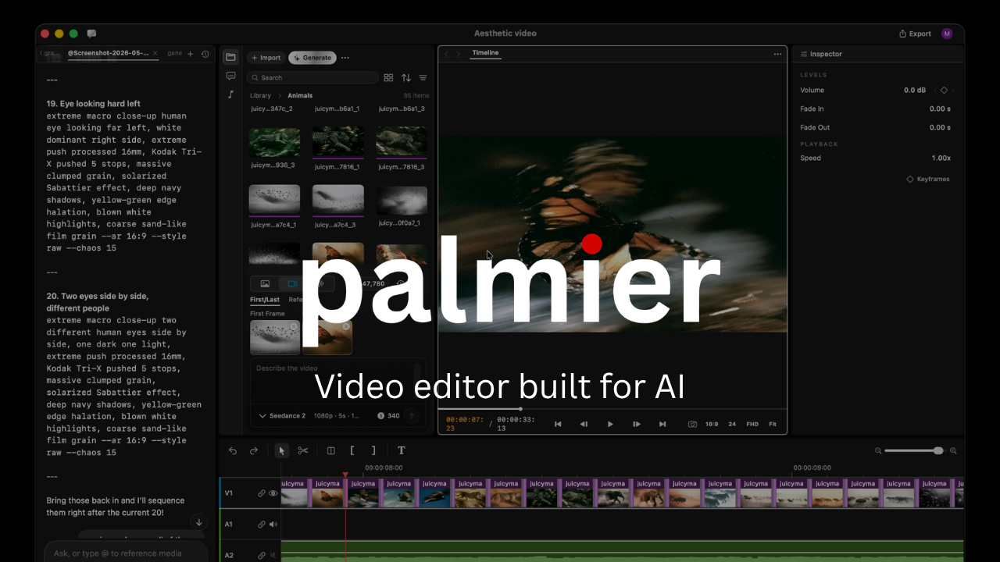

> [!IMPORTANT]
> Compositor Pro releases are proprietary to Compositor Pro, and the app runs
> fully offline. See `BINARY_LICENSE.md`.

<div align="center">

# Compositor Pro

**The video editor built for AI.**

<a href="https://github.com/compositor-pro/compositor-pro/releases/latest/download/CompositorPro.dmg">
  
</a>

<sub><i>Requires macOS 26 (Tahoe) on Apple Silicon</i></sub>

<a href="https://x.com/CompositorPro"></a>
<a href="https://discord.com/invite/SMVW6pKYmg"></a>

<p>
  <strong>English</strong> ·
  <a href="docs/readme/README.es.md">Español</a> ·
  <a href="docs/readme/README.zh-CN.md">简体中文</a> ·
  <a href="docs/readme/README.zh-TW.md">繁體中文</a> ·
  <a href="docs/readme/README.ja.md">日本語</a> ·
  <a href="docs/readme/README.ko.md">한국어</a> ·
  <a href="docs/readme/README.vi.md">Tiếng Việt</a> ·
  <a href="docs/readme/README.hi.md">हिन्दी</a> ·
  <a href="docs/readme/README.bn.md">বাংলা</a> ·
  <a href="docs/readme/README.ar.md">العربية</a> ·
  <a href="docs/readme/README.it.md">Italiano</a> ·
  <a href="docs/readme/README.pt-BR.md">Português (Brasil)</a> ·
  <a href="docs/readme/README.fr.md">Français</a> ·
  <a href="docs/readme/README.ru.md">Русский</a> ·
  <a href="docs/readme/README.tr.md">Türkçe</a>
</p>

</div>



---

Compositor Pro is a macOS video editor with built-in AI generation and MCP support, allowing agents to create and edit directly on the timeline.

### Swift-native video editor

We built Compositor Pro from scratch with Swift. The north star is Premiere Pro, with our take on integrating AI into the workflow.

### Built-in Generative AI

Generate videos and images with SOTA models like Seedance, Kling, Nano Banana Pro inside the timeline editor.

### Integrates with your agents

Connects your Claude/Codex/Cursor via MCP, or use the in-app agent to work on the same project together.

## MCP server

When the app is open, it exposes an MCP server at `http://127.0.0.1:19789/mcp` via HTTP. To connect:

**Claude Code**
```bash
claude mcp add --transport http compositor-pro http://127.0.0.1:19789/mcp
```

**Codex**
```bash
codex mcp add compositor-pro --url http://127.0.0.1:19789/mcp
```

**Cursor**

The easiest way is go inside the app `Help` -> `MCP Instructions` -> `Install in Cursor`, or install manually by adding this to `~/.cursor/mcp.json`:

```
{
  "mcpServers": {
    "compositor-pro": {
      "type": "http",
      "url": "http://127.0.0.1:19789/mcp"
    }
  }
}
```

**Claude Desktop**

We bundle a [mcpb](https://github.com/modelcontextprotocol/mcpb) with the app that allows a one click install Desktop Extension on Claude Desktop. Go to `Help` -> `MCP Instructions` -> `Install in Claude Desktop`

## FAQ

**Which versions of Compositor Pro are open source?**

Releases through v0.7.6 and source through `last-gpl-source` remain available under GPLv3. Later releases are proprietary.

**What platforms does it support?**

macOS 26 (Tahoe) or later on Apple Silicon (M series) only.

## Contributing

This repository no longer accepts code contributions. The published source remains available for use, modification, and redistribution under GPLv3.

## Community &amp; Support

- **Discord:** Join the community on **[Discord](https://discord.com/invite/SMVW6pKYmg)**.
- **Twitter / X:** Follow **[@CompositorPro](https://x.com/CompositorPro)** for updates and announcements.
- **Instagram:** Follow [@compositorpro](https://www.instagram.com/compositorpro) 
- **Feedback &amp; Support:** Email support@compositor.pro.

## License

Copyright (C) 2026 Compositor Pro

The source code published in this repository remains available under [GPLv3](LICENSE).

Compositor Pro binary releases after v0.7.6 are proprietary and subject to the [binary license](BINARY_LICENSE.md).
