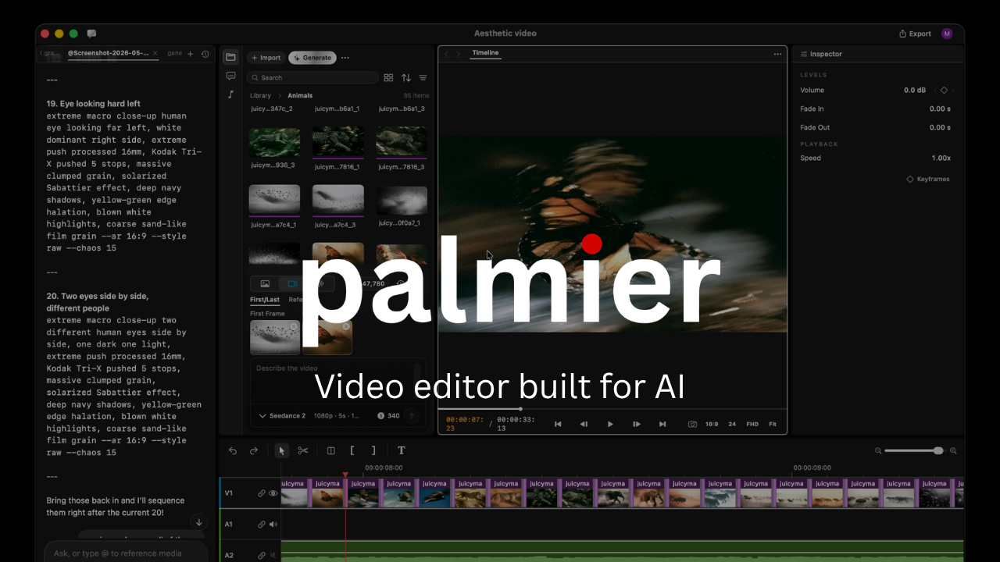

> Esta traducción fue generada por IA. Si encuentras un error, abre un PR.

<div align="center">

# Compositor Pro

**El editor de video creado para IA.**

<a href="https://github.com/palmier-io/compositor-pro/releases/latest/download/CompositorPro.dmg">
  
</a>

<sub><i>Requiere macOS 26 (Tahoe) en Apple Silicon</i></sub>

<a href="https://x.com/CompositorPro"></a>
<a href="https://discord.com/invite/SMVW6pKYmg"></a>
<a href="https://www.ycombinator.com/companies/palmier"></a>
<br />

<p>
  <a href="../../README.md">English</a> ·
  <strong>Español</strong> ·
  <a href="README.zh-CN.md">简体中文</a> ·
  <a href="README.zh-TW.md">繁體中文</a> ·
  <a href="README.ja.md">日本語</a> ·
  <a href="README.ko.md">한국어</a> ·
  <a href="README.vi.md">Tiếng Việt</a> ·
  <a href="README.hi.md">हिन्दी</a> ·
  <a href="README.bn.md">বাংলা</a> ·
  <a href="README.ar.md">العربية</a> ·
  <a href="README.it.md">Italiano</a> ·
  <a href="README.pt-BR.md">Português (Brasil)</a> ·
  <a href="README.fr.md">Français</a> ·
  <a href="README.ru.md">Русский</a> ·
  <a href="README.tr.md">Türkçe</a>
</p>

</div>



---

> [!IMPORTANT]
> Las versiones de Compositor Pro hasta la v0.7.6 inclusive se publicaron bajo GPLv3. La última instantánea pública del código fuente es [`last-gpl-source`](https://github.com/palmier-io/compositor-pro/tree/last-gpl-source). Las versiones posteriores a la v0.7.6 son propietarias y su código fuente no se publica aquí.

Compositor Pro es un editor de video para Mac. Tú y tu agente pueden generar y editar videos juntos dentro de la línea de tiempo.

### Editor de video nativo en Swift

Construimos Compositor Pro desde cero con Swift. La referencia es Premiere Pro, con nuestra forma de integrar IA en el flujo de trabajo.

### IA generativa integrada

Genera videos e imágenes con modelos de vanguardia como Seedance, Kling y Nano Banana Pro dentro del editor de línea de tiempo.

### Integración con tus agentes

Conecta Claude, Codex o Cursor mediante MCP, o usa el agente integrado en la app para trabajar juntos en el mismo proyecto.

## Servidor MCP

Cuando la app está abierta, expone un servidor MCP en `http://127.0.0.1:19789/mcp` mediante HTTP. Para conectarlo:

**Claude Code**
```bash
claude mcp add --transport http compositor-pro http://127.0.0.1:19789/mcp
```

**Codex**
```bash
codex mcp add compositor-pro --url http://127.0.0.1:19789/mcp
```

**Cursor**

La forma más fácil es abrir `Help` -> `MCP Instructions` -> `Install in Cursor` dentro de la app, o instalarlo manualmente agregando esto a `~/.cursor/mcp.json`:

```
{
  "mcpServers": {
    "compositor-pro": {
      "type": "http",
      "url": "http://127.0.0.1:19789/mcp"
    }
  }
}
```

**Claude Desktop**

Incluimos un [mcpb](https://github.com/modelcontextprotocol/mcpb) con la app que permite instalar la extensión de escritorio en Claude Desktop con un clic. Abre `Help` -> `MCP Instructions` -> `Install in Claude Desktop`.

## FAQ

**¿Qué versiones de Compositor Pro son de código abierto?**

Las versiones hasta la v0.7.6 inclusive y el código fuente hasta [`last-gpl-source`](https://github.com/palmier-io/compositor-pro/tree/last-gpl-source) siguen bajo GPLv3; las versiones posteriores son propietarias.

**¿Es gratis?**

El editor es gratis. Puedes descargarlo sin iniciar sesión y usarlo como editor de video, como CapCut o Adobe Premiere. También puedes usar el servidor MCP gratis y empezar a experimentar con Claude Code, Claude Desktop o Cursor para interactuar con tu editor de línea de tiempo.

Las funciones de IA generativa requieren inicio de sesión y suscripción.

**¿Qué plataformas admite?**

Solo macOS 26 (Tahoe) en Apple Silicon.

## Contribuciones

Este repositorio ya no acepta contribuciones de código. El código fuente publicado sigue disponible para su uso, modificación y redistribución bajo GPLv3.

## Comunidad y soporte

- **Discord:** Únete a la comunidad en **[Discord](https://discord.com/invite/SMVW6pKYmg)**.
- **Twitter / X:** Sigue a **[@CompositorPro](https://x.com/CompositorPro)** para novedades y anuncios.
- **Instagram:** Sigue a [@compositorpro](https://www.instagram.com/compositorpro).
- **Feedback y soporte:** Escríbenos a support@compositor.pro.

## Licencia

Copyright (C) 2026 Compositor Pro

El código fuente publicado en este repositorio permanece bajo [GPLv3](../../LICENSE). Las versiones binarias posteriores a la v0.7.6 son propietarias bajo [BINARY_LICENSE.md](../../BINARY_LICENSE.md).
